<h1 align="center">AJYAL – Integrated Management System</h1>
<p align="center"><b>An organizational management platform for a non-profit, built with Flutter for Android &amp; Web from a single codebase.</b></p>

<p align="center">
  
  
  
  
  
  
</p>

<p align="center">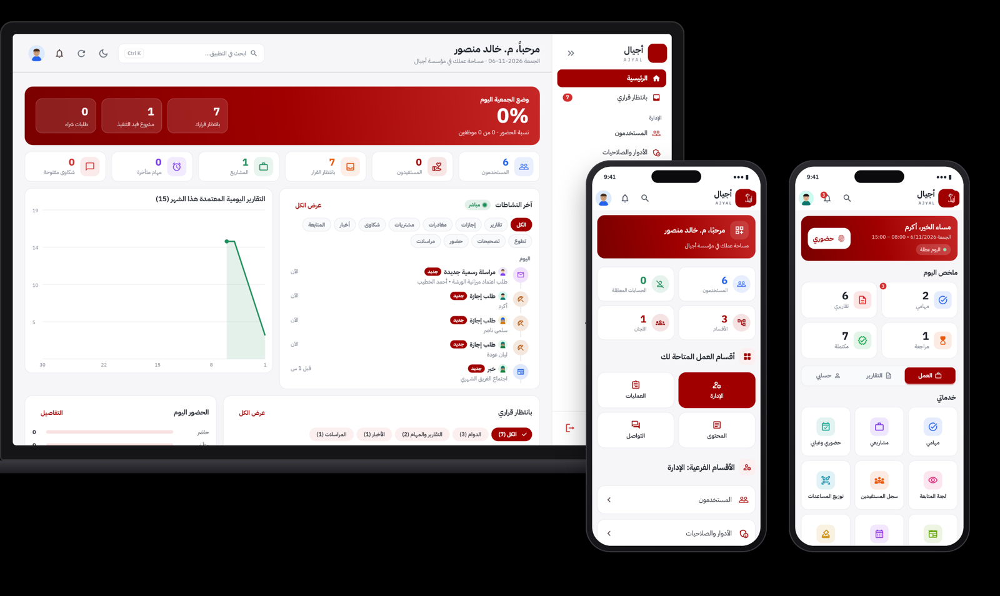</p>

> ℹ️ **This is a showcase repository.** The source code is private because the system is used by a real organization and contains its configuration. This page documents the project, its architecture, and screenshots. All data shown in the screenshots is demo data.

---

## 📌 Overview

AJYAL replaces paper forms and scattered messaging with one system for the whole organization. Every request, report, and task is entered once, reaches the right decision-maker instantly, and is archived in one place.

| | |
|---|---|
| **36** | services in one system |
| **26 × 6** | permission matrix (modules × actions) |
| **2** | platforms from one codebase (Android & Web) |
| **400+** | automated tests (unit, widget, golden) |

---

## ✨ Key Features

- **Daily reports & approvals** — staff submit reports with photos; managers approve with one tap; staff are notified instantly.
- **"Pending my decision" inbox** — leaves, reports, tasks, correspondence, news, and monitoring reports in one queue.
- **Fine-grained permissions** — 26 modules × 6 actions (view, create, edit, approve, export, delete), from roles, personal grants, units/committees, or delegation.
- **Monitoring committee** — field and electronic follow-up with photo/file attachments and a multi-stage approval workflow.
- **Tasks & projects** — deadlines, evidence files, team reports, and project budgets.
- **Attendance & leave** — check-in/out, leave balances, hourly permissions, and Excel exports.
- **Offline-first** — data stays available without internet and pending changes sync automatically.
- **Notifications** — real-time push notifications for every decision and update.
- **Biometric login**, **Arabic/English RTL** interface, **dark mode**, and **PDF/Excel** reports.

---

## 🔐 Security by Design

Coming from a cybersecurity background, security was built into the architecture from day one:

- **Server-side authorization:** every permission is enforced in PostgreSQL with **Row Level Security (RLS)** policies and secured SQL functions — hiding a button in the UI is never the only protection.
- **Defense in depth:** the app checks permissions for UX, and the server re-checks them for every read and write.
- **Least privilege:** each user only sees and changes what their role, unit, or delegation allows.
- **Guard triggers** prevent privilege escalation (e.g. users cannot grant permissions to themselves or join privileged units on their own).
- **Secrets stay out of the client:** service keys live only on the server; push notifications are sent from server-side Edge Functions.
- **Per-account biometric lock** on mobile, cleared automatically when the signed-in account changes.

---

## 🏗️ Architecture

```
┌────────────────────────── Flutter App (Android & Web) ──────────────────────────┐
│  Views (UI only)  →  ViewModels (state + business rules)  →  Models (fromRow/toRow) │
│                              │                                                     │
│                     TableSync + AppData  (local cache · offline queue · realtime)  │
└──────────────────────────────┬─────────────────────────────────────────────────────┘
                               │
        ┌──────────────────────┴───────────────────────┐
        │                                              │
   Supabase                                         Firebase
   • PostgreSQL + Row Level Security                • Authentication
   • Storage (photos & files)                       • Cloud Messaging (push)
   • Realtime                                       • Hosting (web)
   • Edge Functions
```

- **Pattern:** MVVM with `ChangeNotifier` view models.
- **Feature-first structure:** each feature has its own `models/`, `viewmodels/`, `views/`, and `repositories/`.
- **Database changes** are shipped as numbered SQL migration files, each with a rollback.

---

## 🖼️ Screenshots

### Web

| Management dashboard | Roles & permissions |
|---|---|
| 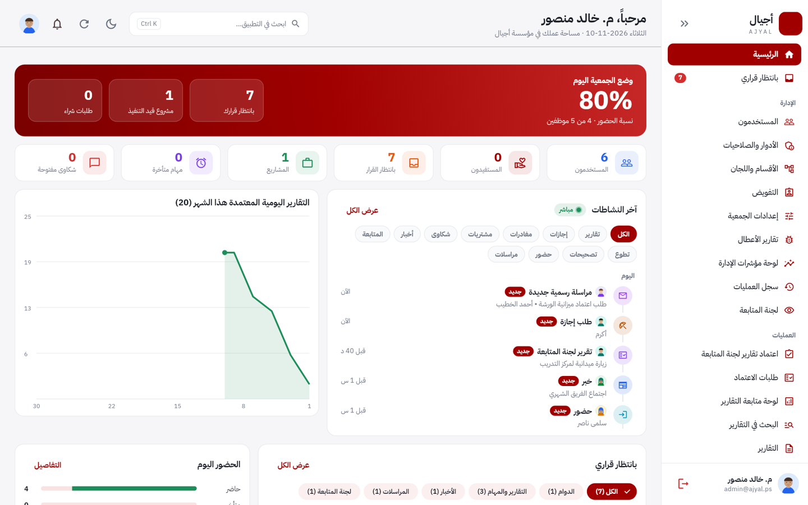 | 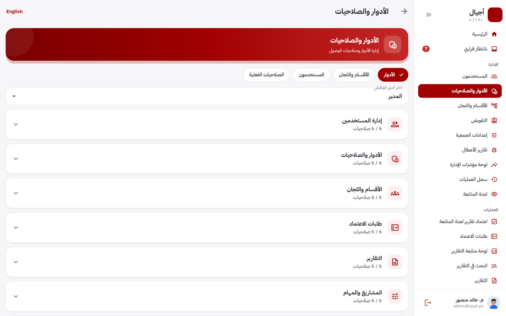 |
| **Monitoring committee** | **Dark mode** |
| 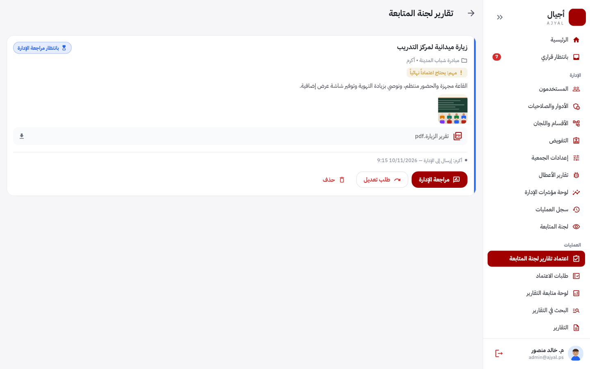 | 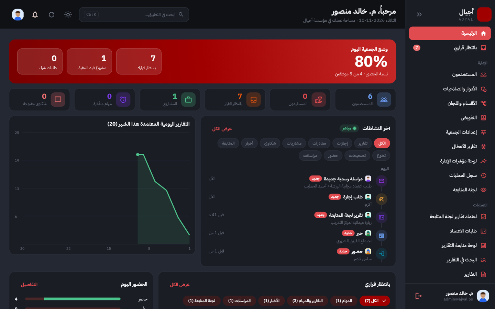 |

### Mobile

| Home | Attendance | Daily reports |
|---|---|---|
| 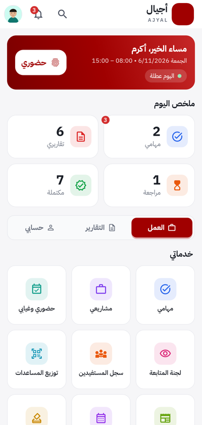 | 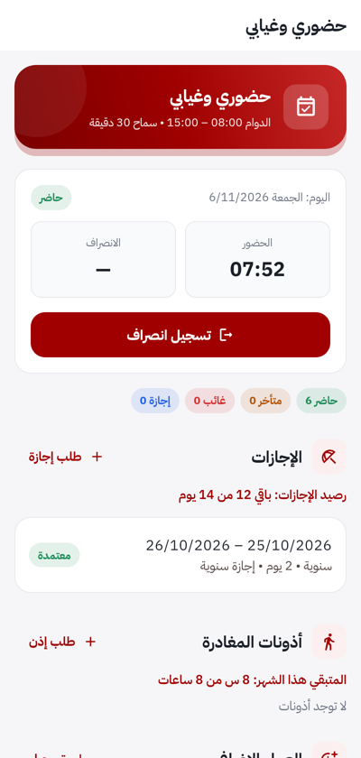 | 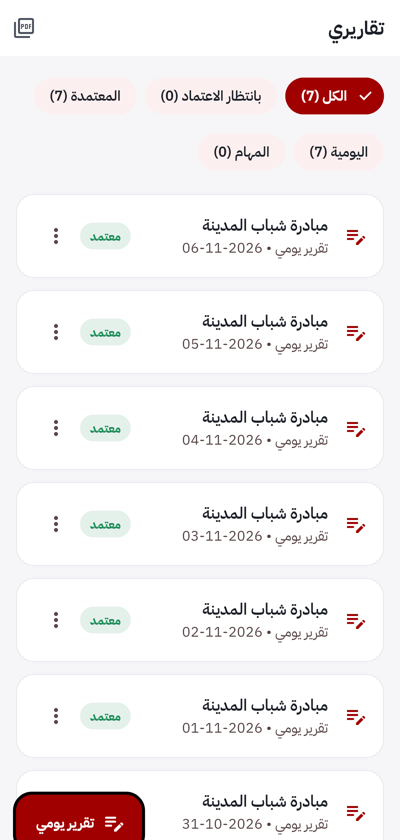 |
| **Pending my decision** | **Tasks** | **Notifications** |
| 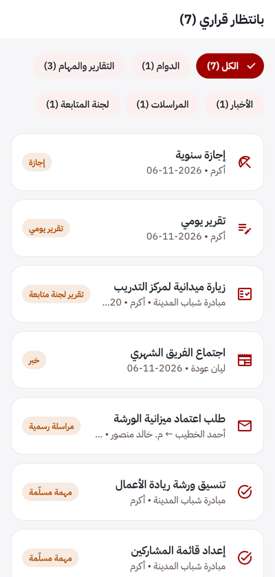 | 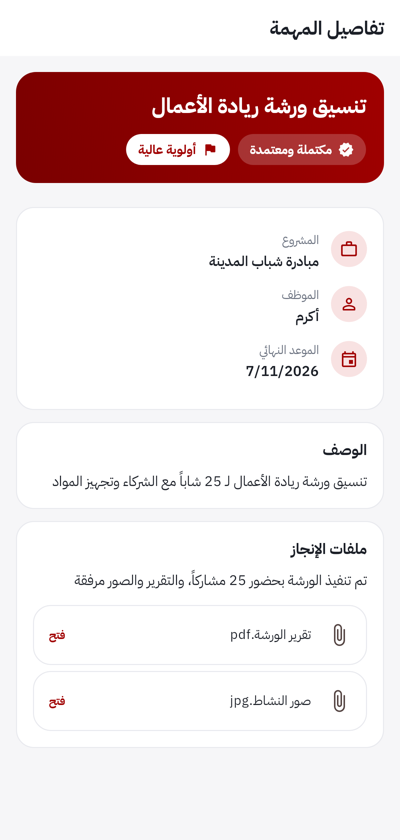 | 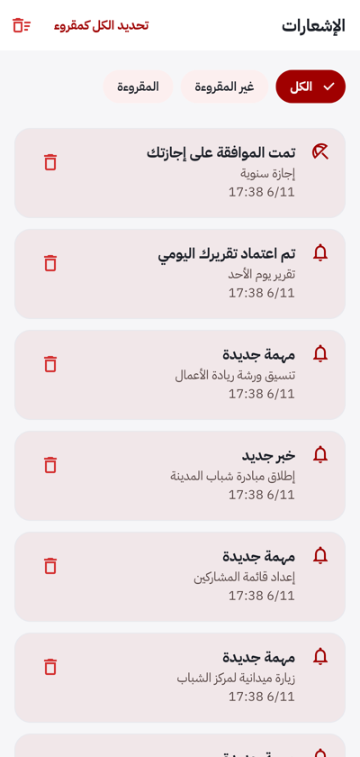 |

---

## 🧪 Quality

- 400+ automated tests: unit tests for view models, widget tests for screens, and golden (screenshot) tests.
- `flutter analyze` and `dart format` on every change.
- Every update ships with written manual test steps and a rollback package.

---

## 🧰 Tech Stack

`Flutter` · `Dart` · `Supabase (PostgreSQL, RLS, Storage, Realtime, Edge Functions)` · `Firebase (Auth, Cloud Messaging, Hosting)` · `local_auth` · `flutter_secure_storage` · `pdf` · `excel`

---

## 👤 Author

Designed and developed by **Eng. Ahmad Akram Abu Elajeen**.

📩 Contact: [LinkedIn](https://www.linkedin.com/in/ahmad-akram-abu-elajeen-07a4aa24b) · aa.aajeen@gmail.com
